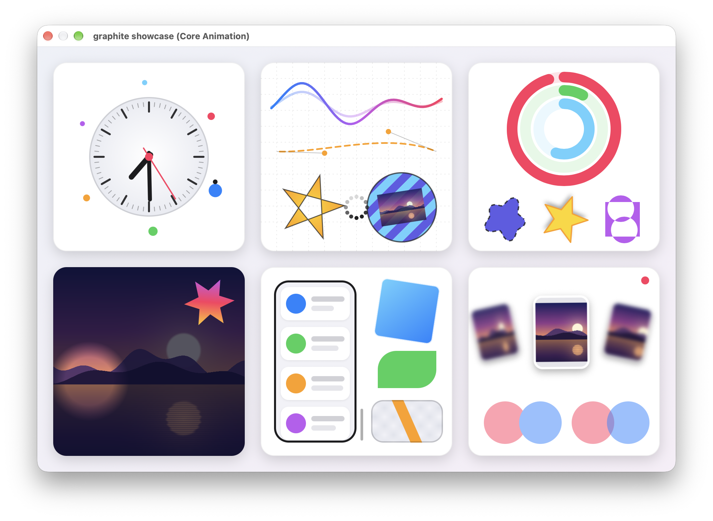
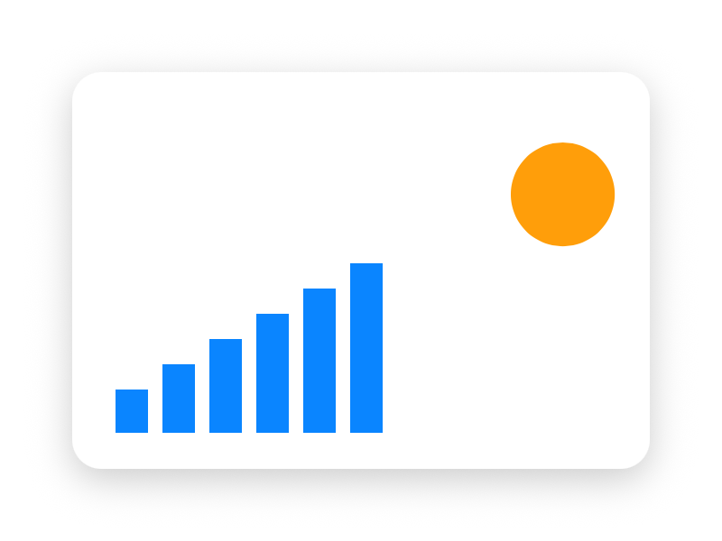

# Graphite



A cross-platform, retained-mode 2D compositing library with an immediate-mode
drawing API, written in C11. You build a tree of layers, and Graphite realizes
them onto the platform compositor: Core Animation on macOS, GTK / GSK on Linux,
and Windows Composition on Windows.

- **Layers**: containers, shapes, gradients and content layers, with frames,
  transforms, opacity, corner radii, borders, shadows, blur, clipping and masks.
- **Canvas**: content layers draw on demand with paths, strokes, dashes,
  gradients, images, clips and transforms.
- **Text**: attributed text, layout and glyph-level drawing through each
  platform's text system.
- **Unconstrained Updating**: change properties whenever you like. The backend
  commits pending changes at the platform's own commit point, and you can also
  render offscreen into pixels.

## A quick look

```c
#include <graphite/graphite.h>

#include <math.h>

/* Runs when the layer needs content and records drawing commands. */
static void draw_bars(void *userdata, gr_canvas *canvas, const gr_draw_info *info)
{
    (void)userdata;
    gr_paint *blue = gr_paint_new(&(gr_paint_desc){.kind = GR_PAINT_SOLID, .value.solid = {0.04f, 0.52f, 1, 1}});
    for (int i = 0; i < 6; ++i)
    {
        double height = 24 + 14 * i;
        gr_canvas_fill_rect(canvas, (gr_rect){{i * 26.0, info->bounds.size.height - height}, {18, height}}, blue);
    }
    gr_paint_unref(blue);
}

gr_scene *make_scene(void)
{
    gr_scene *scene = gr_scene_new((gr_size){400, 300});

    /* A rounded white card with a soft shadow. */
    gr_layer *card = gr_layer_new(scene, GR_LAYER_CONTAINER);
    gr_layer_set_frame(card, (gr_rect){{40, 40}, {320, 220}});
    gr_layer_set_background(card, &(gr_color){1, 1, 1, 1});
    gr_layer_set_corner_radius(card, 16);
    gr_layer_set_shadow(card, &(gr_shadow){.color = {0, 0, 0, 0.2f}, .offset = {0, 6}, .blur_sigma = 10});
    gr_layer_add_child(gr_scene_get_root(scene), card);

    /* A vector shape: an orange circle. */
    gr_path_builder *builder = gr_path_builder_new();
    gr_path_builder_add_ellipse(builder, (gr_rect){{0, 0}, {48, 48}});
    gr_path *circle = gr_path_builder_finish(builder);
    gr_paint *orange = gr_paint_new(&(gr_paint_desc){.kind = GR_PAINT_SOLID, .value.solid = {1, 0.62f, 0.04f, 1}});
    gr_layer *dot = gr_layer_new(scene, GR_LAYER_SHAPE);
    gr_layer_set_frame(dot, (gr_rect){{248, 24}, {48, 48}});
    gr_shape_layer_set_path(dot, circle);
    gr_shape_layer_set_fill(dot, orange);
    gr_layer_add_child(card, dot);

    /* Immediate-mode drawing inside a retained layer. */
    gr_layer *bars = gr_layer_new(scene, GR_LAYER_CONTENT);
    gr_layer_set_frame(bars, (gr_rect){{24, 80}, {160, 120}});
    gr_content_layer_set_drawer(bars, &(gr_drawer){.draw = draw_bars});
    gr_layer_add_child(card, bars);

    /* Parents keep their children and layers keep their resources, so local references can go. */
    gr_path_builder_unref(builder);
    gr_path_unref(circle);
    gr_paint_unref(orange);
    gr_layer_unref(dot);
    gr_layer_unref(card);
    gr_layer_unref(bars);
    return scene;
}
```

The code above renders like this:



Every object is an opaque, reference-counted handle: `*_new` returns a reference
you own and `*_unref` releases it. Setters return a `gr_result` (`GR_OK` on
success). See the full conventions in [types.h](include/graphite/types.h).

To show the scene, attach it to a native view, then just change properties
from your display callback:

```c
gr_scene *scene = make_scene();

/* macOS: an NSView filling the window (GTK: gr_gtk_attach, Windows: gr_windows_attach_to_hwnd).
 * Every platform returns the same gr_scene_host handle. */
gr_scene_host *host = gr_macos_attach_to_view(scene, (__bridge void *)window.contentView);

/* Now you can update the layers anytime. The backend commits the changes for you. */
gr_layer_set_position(...);
gr_layer_set_transform(...);
```

For offscreen rendering, `gr_macos_offscreen_new`, `gr_gtk_attach_offscreen` and
`gr_windows_offscreen_new` render the same scene into RGBA pixels.

## Run the examples

```sh
cmake -S . -B ../graphite-build -DCMAKE_BUILD_TYPE=Release
cmake --build ../graphite-build --parallel
../graphite-build/examples/showcase/showcase
```

Each one is at `examples/<name>/<name>` in the build directory and accepts
`--fps` (report the frame rate) or `--snapshot <out.png>`.

- **macOS** 14 or later works out of the box.
- **Linux** needs GTK 4.22+ development headers with `-DGRAPHITE_GTK=ON`.
- **Windows 11**: use a Visual Studio developer prompt. The Visual Studio
  generator ignores `CMAKE_BUILD_TYPE`, so build with `--config Release` and look
  in `examples\<name>\Release\` (`bin\Release\` for shared builds), or configure with `-G Ninja` to keep the layout above.

See the [examples guide](examples/README.md) for how they are put together and
how to add one.

## Use it in your project

Install Graphite into a prefix, then find it from CMake:

```cmake
find_package(graphite 0.0.1 CONFIG REQUIRED COMPONENTS macos) # or gtk, windows
target_link_libraries(my_app PRIVATE graphite::macos)
```

`graphite::graphite` is the platform-independent core. Each platform target links
it for you. The [CMake guide](docs/cmake.md) covers installing, static or shared
packages, and the build options.

## Developing Graphite

```sh
cmake --build ../graphite-build --target check
```

`check` builds everything, verifies formatting with clang-format 18 and runs the
tests. Native rendering tests need a graphical session and core-only CI does not.

- [Documentation](docs/README.md): architecture, layer semantics, lifetime and backends
- [Public API conventions](include/graphite/types.h)
- [Conformance](conformance/README.md)
- [Benchmarks](benchmarks/README.md)

## License

Graphite is released under the [MIT License](LICENSE).
